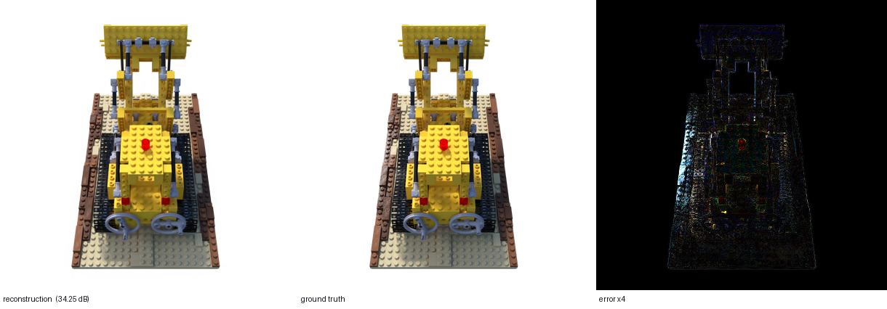
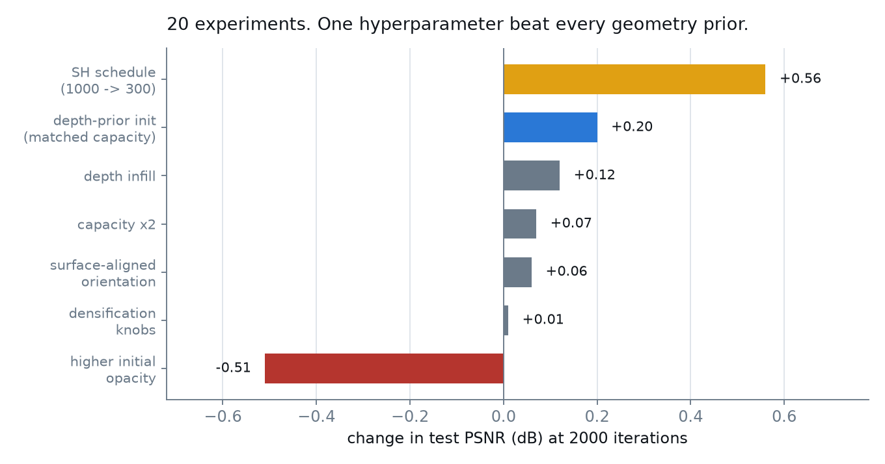
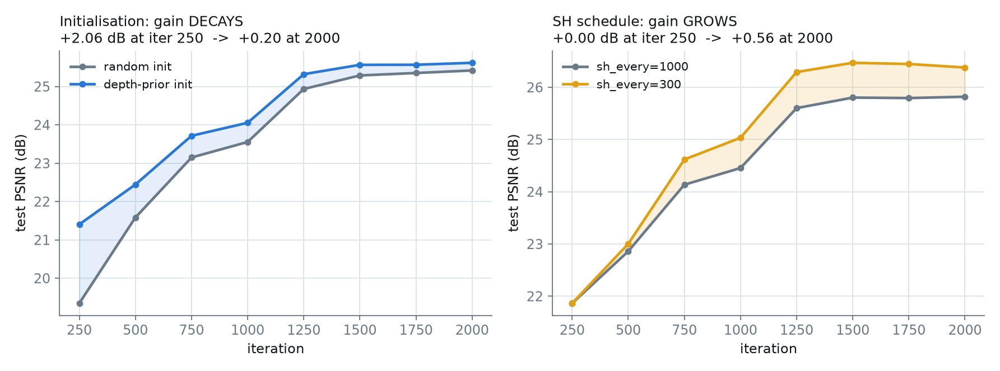
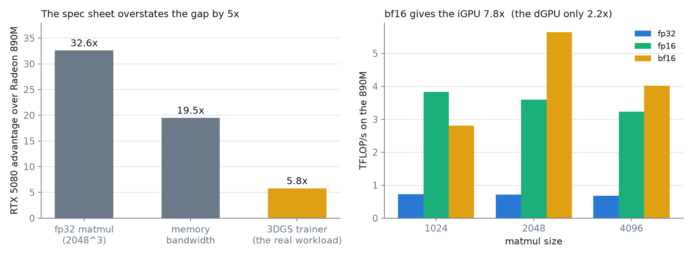
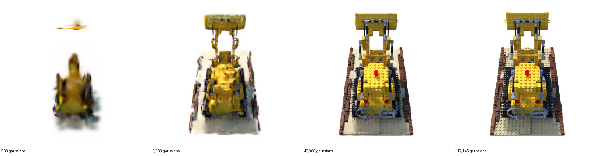
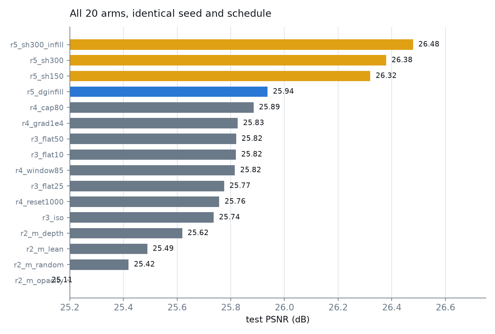

# Plain Gaussian Splats

**3D Gaussian Splatting written from scratch in plain PyTorch — no CUDA, no custom kernels — trained to 27.8 dB on a 25-watt integrated GPU.**

<p align="center">
  
</p>

Every differentiable operation is an ordinary PyTorch op, so the same ~600 lines run on AMD (ROCm), NVIDIA (CUDA) or CPU unchanged. The reference implementation and `gsplat` both ship hand-written CUDA rasterizers that will not build on an AMD GPU; this one has no kernels to build.

Along the way the engineering got measured rather than assumed, and two of those measurements turned out to be more interesting than the renderer.

---

## TL;DR — three findings

| | finding | evidence |
|---|---|---|
| **1** | **One hyperparameter beat every geometry prior.** Rescaling the spherical-harmonic warm-up schedule was worth **+0.56 dB** — 8× more than the best initialisation trick, across 20 controlled runs. | [fig 1](#1-what-actually-mattered) |
| **2** | **Initialisation buys time, not quality.** Five structurally different priors all showed the same signature: large early gain decaying to ≈0. Adaptive density control rebuilds whatever you don't give it. | [fig 2](#2-two-signatures) |
| **3** | **The spec sheet overstates the GPU gap by 5×.** This workload runs **6× slower** on a Radeon 890M than an RTX 5080, not the 32× fp32 throughput predicts — it is bandwidth-bound at 0.25 FLOP/byte against a 129 FLOP/byte machine balance. | [fig 3](#3-the-hardware-story) |

---

## 1. What actually mattered

Twenty training runs, identical seed and schedule, one variable at a time.

<p align="center"></p>

Rounds 1–4 tested increasingly sophisticated geometry priors — monocular-depth positions, four sampling strategies, surface-aligned orientations, opacity, seed count, capacity, and four densification knobs. **Everything landed between 25.7 and 25.9 dB regardless of mechanism.**

The reason was not geometry. With `sh_every=1000` over a 2,000-iteration run, the model sits at **SH degree 0 for the first half of training** and never reaches degree 3 — it is structurally unable to represent view-dependent colour. Nineteen arms were competing for headroom inside a crippled colour model.

> **A schedule tuned for 30,000 iterations is silently broken at 2,000.** The default isn't wrong — it's tuned for the paper's run length, and nobody rescales it when the run gets 15× shorter.

This also explains the single most confusing result in the study: doubling the gaussian budget to 80k produced **+0.07 dB and the model never used the extra capacity** (it stopped at 47,938). With colour saturated, extra gaussians cannot reduce the loss, so position gradients stay below the clone threshold and densification simply halts.

---

## 2. Two signatures

<p align="center"></p>

The two curves are qualitatively different, and the difference is the whole story.

**Left — initialisation.** A monocular depth prior ([DepthAnything V2](https://github.com/DepthAnything/Depth-Anything-V2)) places gaussians on surfaces instead of at random. The effect is enormous early (**+2.06 dB at iteration 250**) because depth-derived points survive pruning — random init loses **86%** of its gaussians at the first densification step, depth init loses **15%**. Then it decays to +0.20 dB and keeps shrinking. On wall-clock the baseline actually wins (13.2 min vs 17.4 min).

**Right — the SH schedule.** Starts at exactly zero, because the schedules are identical until iteration 300, then *grows* as the faster schedule unlocks colour bands the baseline never reaches. Identical gaussian counts, so no capacity confound.

Five priors were tested. All five showed the left-hand shape:

| prior | Δ @250 | Δ @2000 |
|---|---|---|
| depth positions | +2.06 | +0.20 |
| surface-aligned orientation | +0.50 | +0.06 |
| fewer, better seeds | −0.81 | +0.07 |
| depth-guided infill | +0.14 | +0.12 (oscillates sign — noise) |
| higher initial opacity | **−3.39** | **−0.51** |

That last row is instructive: initial opacity of 0.1 is not a pruning hack, it is **curriculum**. Start depth points opaque and they occlude each other before their shapes are right, and the result is *worse than random initialisation*.

---

## 3. The hardware story

<p align="center"></p>

Identical code and flags on both GPUs:

| workload | Radeon 890M (25 W iGPU) | RTX 5080 Laptop | gap |
|---|---|---|---|
| fp32 matmul 2048³ | 0.72 TFLOP/s | 23.50 TFLOP/s | **32.6×** |
| memory bandwidth (measured) | 46 GB/s | ~896 GB/s | 19.5× |
| **3DGS trainer, 100k gaussians** | **1.753 s/iter** | **0.303 s/iter** | **5.8×** |

The rasterizer touches ~20 FLOPs per ~80 bytes — an arithmetic intensity of **0.25 FLOP/byte** against this machine's **129 FLOP/byte** balance point. It is ~500× on the bandwidth-bound side, so the 5080's tensor cores are irrelevant and its bandwidth advantage is diluted by per-launch overhead that is roughly vendor-independent.

**Quote one number for both and you will be wrong by 5×.**

### Other measurements worth having

| | |
|---|---|
| **Tile size obeys a scaling law** | Work per splat ∝ `(2·radius + TILE)²`, so **TILE=8 beats TILE=16 by 1.33×** |
| **Fusion must be scoped** | Compiling the pointwise prefix with Triton: **1.86×** in 18 s. Compiling the whole kernel including `cumprod`'s backward: **never finished** (>20 min) |
| **bf16 is a trap here** | It renders a visually fine image while carrying **41% relative gradient error** |
| **…and why** | `dx = pixel − mean` subtracts two values near 400 to get one near 1. bf16's 8 mantissa bits are worth ±1.6 px at that magnitude — catastrophic cancellation. Differencing in fp32 *then* casting cut image error 17× |
| **MIOpen is broken on gfx1150** | BatchNorm **training** emits a `row_bcast` DPP op the GPU rejects. Workaround `torch.backends.cudnn.enabled = False`, at 4.5× conv slowdown (17 ms → 76 ms) |

---

## How it works

<p align="center"></p>

Each gaussian carries a mean, a scale, a rotation quaternion, an opacity and spherical-harmonic colour. To render:

1. **Project** the mean through a pinhole camera.
2. **Squash the covariance** into 2D via the projection Jacobian, `Σ' = J W Σ Wᵀ Jᵀ`. A gaussian stays a gaussian under an affine map — this is why splatting is fast.
3. **Bin** each splat into the pixel tiles its 3σ ellipse touches.
4. **Sort** by depth within each tile.
5. **Composite** front-to-back: `C = Σ cᵢ αᵢ Tᵢ`, `Tᵢ = Π(1−αⱼ)`.

Then *adaptive density control* clones small high-gradient gaussians, splits large ones, and prunes transparent ones — a heuristic, not gradient descent, and the thing that erases every head start you try to give it.

### Correctness is verified, not eyeballed

| check | result |
|---|---|
| analytic gradients vs central finite differences | agree to **~1e-9** relative |
| tiled compositing vs brute-force reference | **exact**, 0.0 error |
| 2D covariance vs Monte-Carlo projection | 2.9e-03 relative |
| GPU render vs CPU render | 2.4e-07 |
| every GPU op (sort, cumprod, index_add, autograd) vs CPU | all pass |

A rasterizer can render a convincing image with a wrong Jacobian; that only shows up as training which mysteriously plateaus. `01_test_rasterizer.py` checks the backward pass against two independent references.

---

## Full results

<p align="center"></p>

Best configuration reaches **26.48 dB at 2,000 iterations** versus a 25.42 dB baseline (**+1.06 dB**), attributed as: SH schedule **+0.56**, depth-prior init **+0.40**, remainder ~+0.10 (within noise).

The flagship run — 7,000 iterations at 400×400 — reaches **27.80 dB with 117,145 gaussians in 3.19 h, peaking at 1.41 GB**, entirely on the integrated GPU.

Every number above is reproducible from the JSON logs in [`results/`](results/).

---

## Limitations — read this before citing anything

This is an honest engineering study, **not a state-of-the-art claim.**

- **One scene, one seed, 400×400, 2,000 iterations.** SOTA is measured on Mip-NeRF 360 / Tanks & Temples / Deep Blending at full resolution and 30k iterations.
- **The baseline is my rasterizer, not the reference.** Beating it says nothing about beating the reference CUDA implementation, which reaches ~33–35 dB on this scene.
- **The depth pipeline uses two shortcuts that will not generalise.** It takes object masks from the PNG alpha channel (ground-truth segmentation, which real captures lack), and its scale solver assumes cameras orbit a centred object at known radius. Strip those and it is substantially weaker.
- **The solved object radius is not reproducible** (0.50 / 0.60 / 0.70 across runs) — the photo-consistency curve is nearly flat and its sampler draws from the CUDA RNG. Cross-round numbers are therefore not comparable; within-round ones are.
- **Depth-prior initialisation is not novel.** See [InstantSplat](https://instantsplat.github.io/), [DNGaussian](https://arxiv.org/pdf/2403.06912), [Liberated-GS](https://openaccess.thecvf.com/content/ICCV2025/papers/Pan_Liberated-GS_3D_Gaussian_Splatting_Independent_from_SfM_Point_Clouds_ICCV_2025_paper.pdf). Our results replicate theirs; the largest effect we found came from fixing our own misconfiguration.

### Ideas that failed

Kept on the record because negative results are the expensive half of any study:

| idea | outcome |
|---|---|
| higher initial opacity for on-surface points | **−0.51 dB** — occlusion fighting beats the head start |
| "flatter discs are monotonically better" | predicted, then **refuted**: +0.08 / +0.04 / +0.08, no dose-response |
| "the ceiling is the gaussian budget" | predicted, then **refuted** — doubling it gave +0.07 and went unused |
| depth-guided floater pruning | **killed in pre-validation** — scored depth-derived points 0.424 vs random points 0.406, i.e. no discrimination. The prior's own error (median 0.105) exceeds the tolerance it would need |

That last one is a general lesson: **a prior good enough to initialise is not necessarily good enough to supervise.** Initialisation is forgiving because the optimiser corrects you. Supervision is not, because you are overriding the optimiser with something noisier than it is.

---

## Quick start

```bash
conda create -y -n plainsplat python=3.11 && conda activate plainsplat

# AMD / ROCm                                   # NVIDIA / CUDA
pip install torch --index-url \                # pip install torch --index-url \
  https://download.pytorch.org/whl/rocm7.0     #   https://download.pytorch.org/whl/cu128
pip install numpy pillow plotly

./scripts/get_data.sh          # datasets are downloaded, never redistributed

python src/00_verify_gpu.py        # prove the GPU computes correctly, not just that it exists
python src/01_test_rasterizer.py   # prove the math is right, forward AND backward
python src/train.py --bench        # time it before committing hours

python src/train.py --res 400 --iters 7000 --fuse --sh-every 300 --out logs/run
python src/03_export.py --ckpt logs/run/ckpt_last.pt --ply --video --grid
```

`--fuse` enables the Triton pointwise fusion (1.86×). `--cpu` runs the identical code on CPU. `--mem-gb` caps the allocator so a runaway densification cannot take the machine down — it matters on an iGPU, where "VRAM" *is* system RAM.

### Interactive viewer

[`docs/viewer.html`](docs/viewer.html) is a self-contained WebGL viewer — open it in a browser. Drag to orbit, pull the slider down to dissolve the model into its gaussians, and switch **Shape** to `discs` or `outlines` to see the individual ellipses. It runs the same projection math as the PyTorch rasterizer, just on hardware triangles.

### Learn it from scratch

[`notebook/stereo_gaussian_splatting.ipynb`](notebook/stereo_gaussian_splatting.ipynb) — a complete minimal implementation (~120 lines) that takes **two photographs** and learns a splat cloud, with interactive Plotly 3D. Block-matching disparity → `Z = f·B/d` → unproject → optimise. Runs end to end in under 3 minutes.

---

## Repository

| path | what |
|---|---|
| `src/rasterizer.py` | the differentiable tile rasterizer — the core |
| `src/model.py` | gaussian parameters, Adam surgery, adaptive density control |
| `src/train.py` | training loop, L1 + D-SSIM, evaluation |
| `src/00_verify_gpu.py` | proves the GPU is trustworthy before you train on it |
| `src/01_test_rasterizer.py` | forward **and** backward vs independent references |
| `src/02_bench_tile.py` · `04_optimize.py` | tile-size and fusion/bf16 measurements |
| `src/10_depth_init.py` · `11_make_depthmaps.py` | monocular-depth initialisation pipeline |
| `src/depth_guide.py` | depth-guided density control (null result — see above) |
| `scripts/run_r*.sh` | the five experiment rounds, exactly as run |
| `results/*.jsonl` | every training curve behind every number here |

---

## Attribution & licence

Code is released under the MIT licence.

Datasets are **not** redistributed. `scripts/get_data.sh` fetches them from their sources:

- **NeRF-synthetic `lego`** — © Heinzelnisse via [BlendSwap](https://www.blendswap.com/blend/11490), **CC-BY-NC**. The splat model embedded in `docs/viewer.html` is a derivative of this asset and inherits its non-commercial terms.
- **Middlebury 2003 `cones`** — Scharstein & Szeliski, [Middlebury Stereo](https://vision.middlebury.edu/stereo/data/).
- **DepthAnything V2** — [depth-anything/Depth-Anything-V2-Small](https://huggingface.co/depth-anything/Depth-Anything-V2-Small-hf).

Method follows Kerbl et al., *3D Gaussian Splatting for Real-Time Radiance Field Rendering*, SIGGRAPH 2023.

**Aamer Khani**, 2026.
